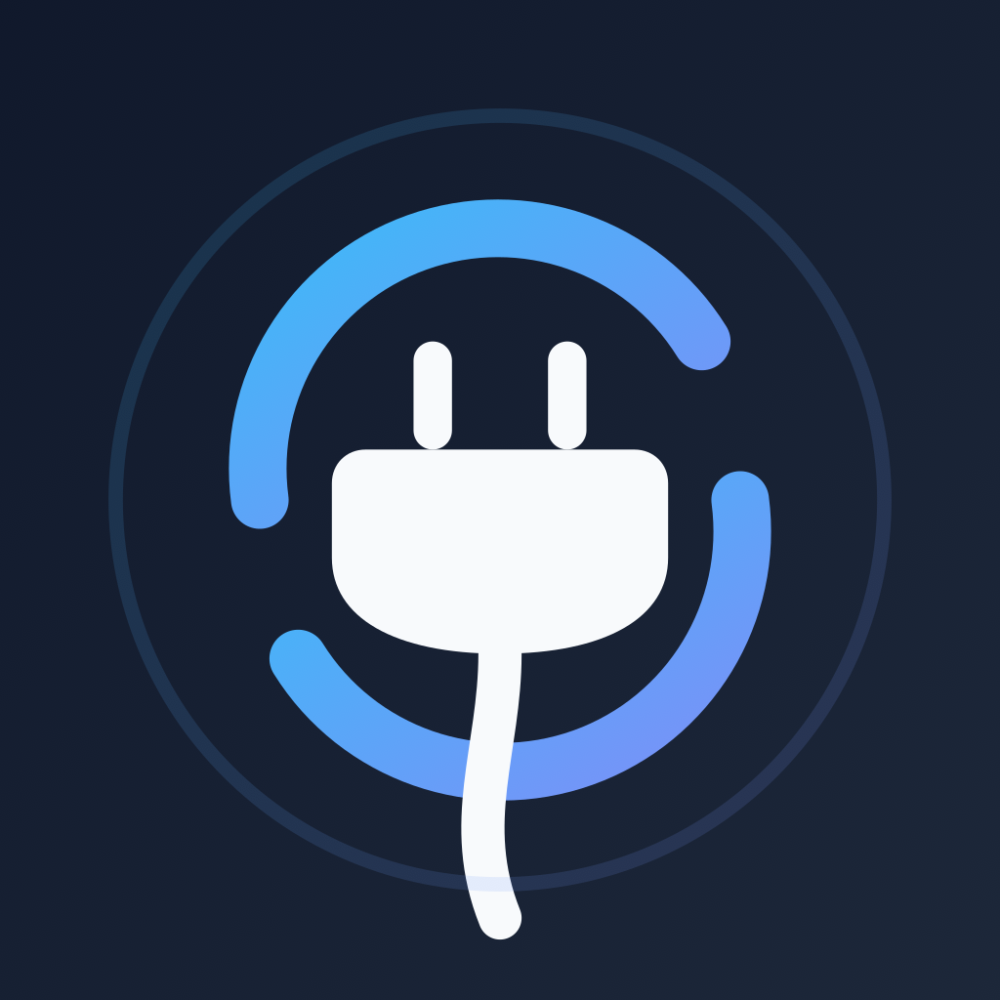

# Unplug

<p align="center">
  
</p>

<p align="center">
  <strong>Take back your time. One mindful decision at a time.</strong>
</p>

<p align="center">
  <a href="https://github.com/EGBYtest/Unplug/releases/latest">
    
  </a>
</p>

<p align="center">
  <strong>Version 1.1.0</strong>
</p>

---

## ⚠️ PLEASE READ FIRST — IMPORTANT WARNINGS ⚠️

**Unplug is a new, unknown app. It is NOT on Google Play. Your phone WILL warn you about it — repeatedly. This is expected. Read this section before installing.**

### Why your phone will flag this app

When you install and set up Unplug, you will very likely see one or more of the following warnings. **All of them are normal for a new side-loaded app, but you should understand what each one means before proceeding:**

1. **"Install unknown apps" / "Unknown app" during installation**
   - Unplug is distributed as an APK from GitHub Releases, not from Google Play.
   - Android requires you to explicitly allow your browser or file manager to install apps from outside the Play Store.
   - Only download the APK from the official Releases page: `https://github.com/EGBYtest/Unplug/releases`. Never install an "Unplug" APK sent to you by anyone else or hosted on a random site.

2. **Google Play Protect warnings ("Unknown app", "May be unsafe", "Blocked by Play Protect")**
   - Play Protect flags apps it has never seen before. Since Unplug is new and has very few installs, it has no reputation with Google, so it gets flagged automatically.
   - This warning says Google **cannot verify** the app — it does **not** mean malware was found.
   - How to stay safe anyway: verify you downloaded it from the official GitHub Releases page, check that the release is published by the repository owner, and optionally compare the SHA-1 checksum published alongside the APK.

3. **Accessibility Service warning ("This app can read your screen", "Full control of your device", "Can observe your actions")**
   - **Unplug cannot work without the Accessibility Service. This is its core function, not an optional extra.**
   - Android shows a very scary system dialog when you enable any accessibility service, warning that the app can "read all screen content" and "perform gestures". Android shows this same text for every accessibility app — screen readers, password managers, automation tools.
   - What Unplug actually uses it for:
     - Detecting which app is currently in the foreground.
     - Detecting when a blocked in-app tab (YouTube Shorts, Instagram Reels, etc.) is opened.
     - Pressing BACK / closing the app when a limit is hit, and showing the lock screen.
   - What Unplug does **not** do with it: it does not record your screen, log keystrokes, or send screen content anywhere (there is no server to send it to — see "100% local" below).
   - Because this permission is so powerful, **never enable the Unplug accessibility service if you did not install the app yourself from the official source.** And if you ever stop trusting the app, turn the service off first (Settings → Accessibility → Downloaded apps → Unplug), then uninstall.

4. **Usage Access permission ("Let app access usage data")**
   - Required so Unplug can read how long you have used each app today (via Android's built-in UsageStats API).
   - Without it, time limits cannot be measured.
   - Granted manually in Android Settings. Unplug cannot grant it silently — only you can.

5. **"Display over other apps" / overlay permission**
   - Required so the lock screen can appear on top of the app you were just using when time runs out.
   - Granted manually in Android Settings. Only you can enable it.

6. **OEM-specific warnings (OxygenOS / ColorOS / MIUI / Samsung)**
   - Some manufacturers add extra steps: auto-start managers, battery-optimization whitelists, or separate "Downloaded apps" accessibility lists.
   - If enforcement seems to stop working after a reboot or after the phone sleeps, check battery optimization exemptions and the accessibility service toggle — aggressive OEM battery savers are the most common cause.
   - **OxygenOS / ColorOS path:** Settings → Accessibility → Downloaded apps → Unplug.

### Rules to stay safe

- **Download only from GitHub Releases on this repository.** Check the URL bar.
- **Review the permissions yourself.** If any permission prompt does not match what is described in this README, stop and ask (open a GitHub issue) before continuing.
- **This app is fully open source — verify it.** Every line of code that ships in the APK is in this repository. You (or someone you trust) can read the Dart UI code in `lib/` and the native enforcement code in `android/app/src/main/kotlin/`. If the code and the release ever stop matching, treat that as a red flag.
- **You are always in control.** All sensitive permissions are granted manually by you in Android Settings and can be revoked manually at any time. Unplug cannot re-enable them itself.

> If any warning makes you uncomfortable, **do not install the app.** No screen-time tool is worth installing software you do not trust. Come back later, read the code, or ask questions in the issue tracker first.

---

## 🔒 100% Open Source, 100% Local

- **Fully open source.** The complete source code — Flutter UI, Kotlin accessibility service, everything — is public in this repository under the project license. No hidden modules, no obfuscated binaries. What you see is what runs.
- **Local to your phone.** No accounts. No sign-up. No cloud sync. No analytics. No tracking SDKs.
  - App groups, time limits, usage history, and bonus time are stored in **SharedPreferences on your device only**.
  - The native Kotlin service reads those same on-device preferences directly. **No network calls happen during enforcement.**
- **The only network request the app ever makes:**
  1. Update checks against the public GitHub Releases API, so the app can tell you when a new version exists.

  Checks are throttled to at most one request every 30 minutes, because GitHub allows only 60 unauthenticated requests per hour per IP — a limit shared by everyone behind the same mobile carrier. Without the throttle, glancing at your phone often enough could spend it, and a rate-limited API falls back to a CDN-cached copy of the version file that can lag a few minutes behind a release.

  Earning bonus time involves **no network access whatsoever** — see [Earn More Time](#earn-more-time--mindfully) below. The 30-second wait is a local timer dialog. The sponsor link it contains opens your browser only if you tap it, and it goes to our own site, not to any ad network or third party.

  Earlier versions also pinged an anonymous install counter (`counterapi.dev`). It was removed in v1.1.2 — the provider retired its v1 API and every request returned `410 Gone`, so it was never actually counting anything.
- If you do not believe these claims, the source is right here — search for `http`, `HttpClient`, and `WebView` yourself and see exactly where every request goes.

---

## What is Unplug?

Unplug helps you reduce mindless scrolling by setting **daily time limits** on app groups and **blocking addictive tabs** like YouTube Shorts, Instagram Reels, and Snapchat Spotlight — without killing the entire app.

When your time runs out, you face a choice: sit through a 30-second wait, or type a 50-word mindfulness message. No easy skips. No "just 5 more minutes" loopholes.

---

## Why Unplug?

### Set Boundaries That Stick
- Create app groups (Social Media, Games, Entertainment...)
- Set a daily limit per group — 30 minutes, 1 hour, or **0 = block immediately**
- Once exhausted, a full-screen lock appears. No way around it.

### Block Addictive Tabs, Not Apps
| App | Blocked Tab | Rest of App |
|-----|-------------|-------------|
| YouTube | Shorts | Subscriptions, search, normal videos |
| Instagram | Reels | Feed, DMs, stories |
| Snapchat | Spotlight | Camera, chat, map |
| Facebook | Reels & Watch | Feed, groups, messenger |
| TikTok | For You / Following feed | Profile, inbox |
| Reddit | Popular / Watch | Subreddits, comments |

Smart detection exits only the blocked tab. The app stays open.

### Earn More Time — Mindfully
| Method | Bonus | The Catch |
|--------|-------|------------|
| Wait 30 seconds | +1 min (configurable, up to 20 min) | The timer resets if you leave the app or shrink the window, so it cannot run in the background |
| Type a 50-word challenge | +1 min | Exact match required. No copy-paste. |

Both are intentionally inconvenient — that's the point. If you really need more time, you'll do it. If not, you'll put the phone down.

The 30-second wait is **not an advertisement and contains no ad SDK**. It is a plain timer dialog that shows a link to [yourwatch.no](https://yourwatch.no), where we sell custom watches. It makes no network requests. If you tap the link, your browser opens our site — that is the only thing it does.

Bonus time is **not drawn down as you use it** — it raises your limit for the day and stays raised. That makes the reward per wait a multiplier on 30 seconds of waiting, so it is capped at **20 minutes**, in whole-minute steps. If you want a tighter budget than that, set it lower; the ceiling only stops the setting from being absurd.

Bonus expires on its own at your reset hour, whether or not you open the app — the day is part of the stored key, so the native limiter cannot see yesterday's balance even if Unplug has not run since.

### Settings That Can't Be Undone on Impulse
- Editing limits, groups, or tab blockers requires completing the same wait-or-type challenge
- Toggle Settings Lock on/off in Settings → Security
- Prevents the "I'll just add 5 more minutes..." spiral

> **Honest scope of the Settings Lock:** it is a friction mechanism, not a security control. The lock flag and your bonus-time balances are plain values in on-device SharedPreferences, which on a rooted phone can be edited or cleared with one command. It stops impulsive you, not someone who is deliberately trying to bypass it. Nothing here stops uninstalling the app.

### See Your Progress
- **Circular ring chart** — total screen time vs. your limit, at a glance
- **Weekly average comparison** — are you trending up or down?
- **Per-group progress bars** — green (safe), yellow (near limit), red (exhausted)
- **Bonus time tracking** — see how much extra time you've earned

---

## Screenshots

<p align="center">
  <em>Dashboard · Lock Screen · Settings · Tab Blockers · Onboarding</em>
</p>

---

## Permissions Required

| Permission | Why | How it is granted |
|-----------|-----|-------------------|
| **Usage Access** | Read how long you've used each app today | Manually, in Android Settings |
| **Accessibility Service** | Detect when time-limited apps open and enforce limits (core function — app does nothing without it) | Manually, in Android Settings → Accessibility → Downloaded apps → Unplug |
| **Display over other apps** | Show the lock screen on top of the timed-out app | Manually, in Android Settings |

Unplug cannot grant or modify any of these itself — only you can, and only you can revoke them.

**OxygenOS / ColorOS users:**
Settings → Accessibility → Downloaded apps → Unplug

> ⚠️ When enabling the Accessibility Service, Android will warn that Unplug can "read screen content" and "perform actions". This is the standard system warning shown for every accessibility service. See the "PLEASE READ FIRST" section at the top for what Unplug actually does with this access — and remember the code is open for you to verify.

---

## Download

**[Download v1.0.0 APK](https://github.com/EGBYtest/Unplug/releases/tag/v1.0.0)** from GitHub Releases.

Requirements:
- Android 11+ (API 30)
- ~24 MB download

> **Note:** Not available on Google Play. Side-loading required — enable "Install unknown apps" for your browser or file manager. Expect a Play Protect warning since this is a new app with no reputation (see warnings section above). Verify the download comes from this repository's Releases page.

---

## How It Works

Unplug runs an **Android Accessibility Service** that watches which app is in the foreground in real-time. When a time-limited app opens:

1. **Check time** — reads today's usage from Android's built-in UsageStats
2. **Check tab** — scans the view hierarchy for banned in-app features (Shorts, Reels, Spotlight...)
3. **Enforce** — if time is up or tab is blocked, presses BACK to exit the feature. If time limit hit, force-closes the app.
4. **Show lock screen** — full-screen popup with wait and typing challenge options

Everything runs on-device. SharedPreferences stores your groups, limits, and bonus time. The native Kotlin service reads these directly — no network calls during enforcement.

---

## For Developers

### Build

```bash
git clone https://github.com/EGBYtest/Unplug.git
cd Unplug
flutter pub get
flutter build apk --release
```

### Tech Stack

| Layer | Tech |
|-------|------|
| UI Framework | Flutter (Cupertino widgets, dark theme) |
| Frontend Language | Dart |
| Native Enforcement | Kotlin (AccessibilityService) |
| Storage | SharedPreferences |
| Usage Tracking | `usage_stats` package |
| Bridge | MethodChannel (Flutter ↔ Android) |

### Architecture

```
Unplug/
├── lib/
│   ├── main.dart                       # Entry point, CupertinoApp, method channel
│   ├── home_screen.dart                # Dashboard with ring chart + stats
│   ├── onboarding_screen.dart          # Permission setup flow
│   ├── settings_screen.dart            # Locked settings (wait/type to unlock)
│   ├── lock_screen_popup.dart          # Non-dismissible lock dialog + bypass
│   ├── screens/
│   │   └── app_picker_screen.dart      # Searchable installed apps list
│   ├── models/
│   │   └── app_group.dart              # AppGroup + BannedFeature models
│   ├── services/
│   │   ├── storage_service.dart        # SharedPreferences persistence
│   │   ├── usage_tracker.dart          # Usage stats queries (dashboard display)
│   │   ├── reward_gate.dart            # 30-second wait timer that grants bonus time
│   │   └── message_verification.dart   # Typing challenge logic
│   └── utils/
│       └── no_paste_formatter.dart     # Clipboard paste blocker
└── android/
    └── android/
    └── app/src/main/kotlin/com/egbytest/unplug/
        ├── MainActivity.kt              # FlutterActivity + MethodChannel
        └── UsageAccessibilityService.kt # Foreground watch + enforcement + tab blocking
```

### Requirements
- Flutter SDK ≥ 3.0.0
- Dart SDK ≥ 3.0.0
- Android API 30+

### Verify a release
1. Check the release tag (`v1.1.0`) and the published `VERSION` file match.
2. Optionally rebuild the APK from the tagged source yourself (`flutter build apk --release`) and compare behavior/checksum expectations.
3. Audit network usage: search the codebase for `HttpClient`, `http`, `WebView`, and `Socket` — every outbound request is in `lib/services/update_checker.dart`. There is no ad SDK and no analytics SDK to find; if you find one, that is a red flag.

### Build notes
- The app version lives in **one** place: the `version:` line in `pubspec.yaml`. `lib/generated/app_version.dart` is generated from it by `tool/gen_version.sh` — never edit that file by hand. Regenerate with `./tool/gen_version.sh` after changing the version.
- Build requires Gradle ≥ 8.14, AGP ≥ 8.11.1, Kotlin ≥ 2.2.20, and NDK 28.x (see `android/`). Older combinations are rejected by current Flutter.

### Tag history note
Releases before v1.0.0 exist twice under two tag series on the same commits: a `v0.x.y` series and a `v1.x.y` series (e.g. `v0.8.7-beta` and `v1.8.7-beta` both point at the same commit). The `v0.x` tags are a retired numbering track kept for history only and are not maintained. Current releases use the `v1.x` series. The in-app update checker reads `releases/latest` from GitHub and is aware of neither series.

---

## Privacy

- No analytics. No tracking. No accounts.
- All data (groups, limits, usage history) stored locally in SharedPreferences — on your phone, nowhere else.
- Update checks query the public GitHub Releases API. That is the only outbound request the app makes.
- The 30-second wait for bonus time is a local timer dialog. It contains no ad SDK and makes no network requests; it links to our own site, which opens in your browser if you tap it.
- Source code is fully open — verify every claim yourself.

---

## License

All rights reserved.
